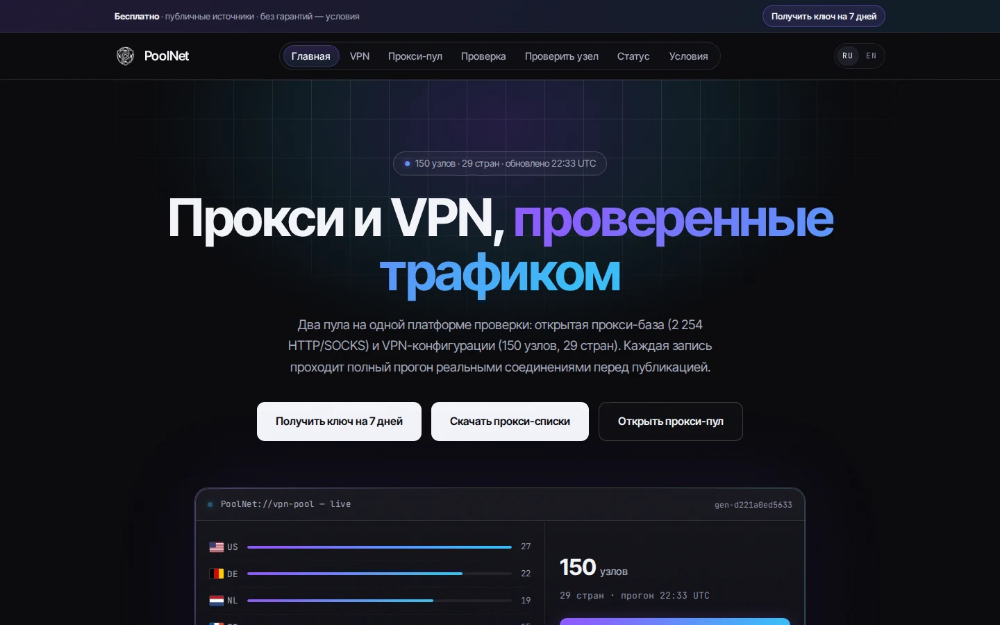
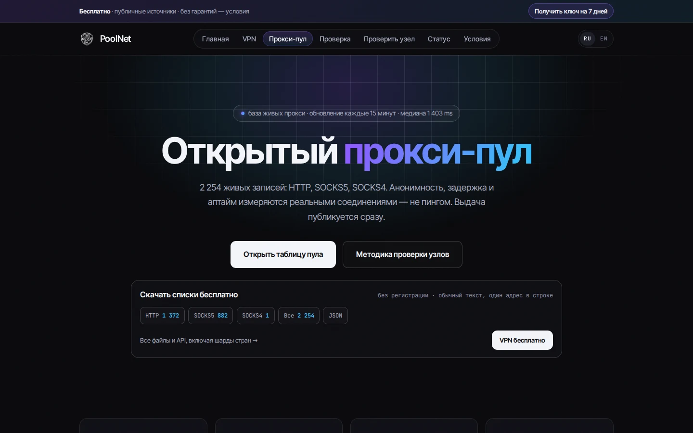
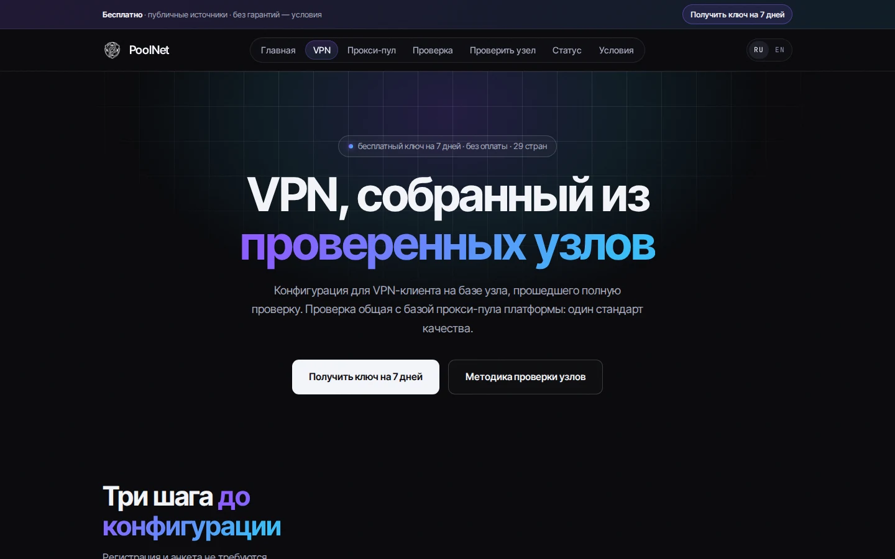
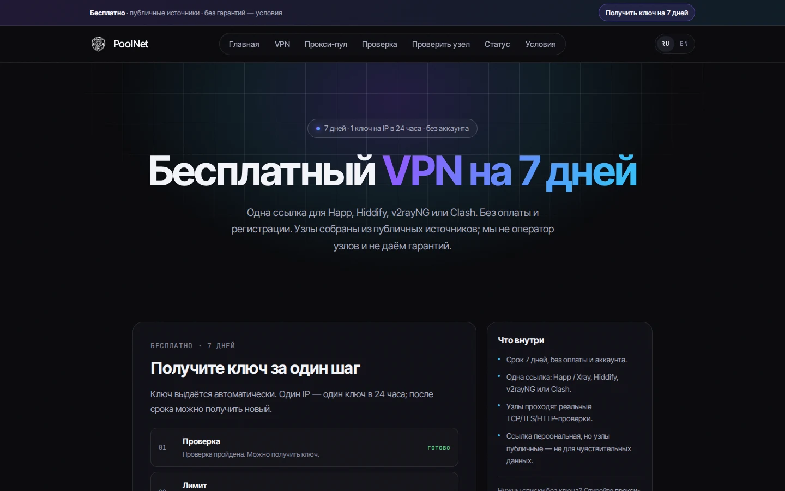
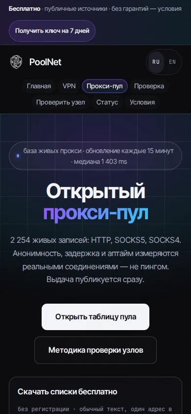
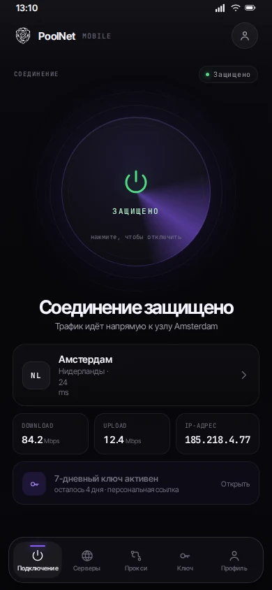
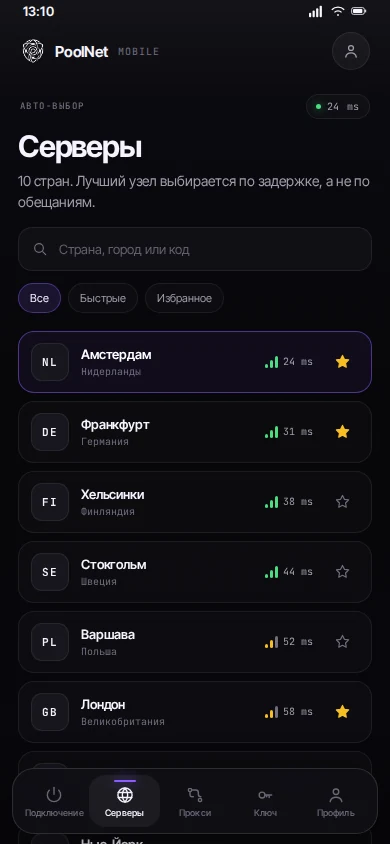
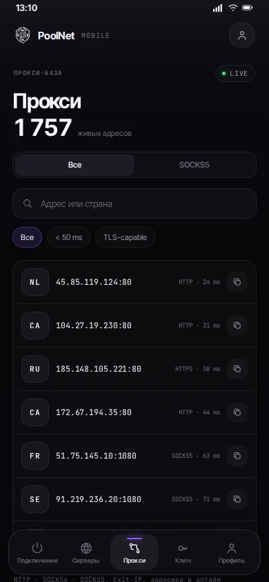

<p align="center"></p>

<h1 align="center">PoolNet</h1>

<p align="center"><a href="README.en.md">English</a> · Русский</p>

<p align="center"><strong>Открытые списки VPN и прокси, проверенные реальными соединениями.</strong><br>
Автообновление каждые 15 минут · бесплатный ключ на 7 дней · без аккаунта</p>

<p align="center">
  <a href="https://poolnet.online"></a>
  <a href="https://github.com/evgen1yby-glitch/poolnet/tree/lists"></a>
  <a href="https://github.com/evgen1yby-glitch/poolnet/tree/lists"></a>
  <a href="https://github.com/evgen1yby-glitch/poolnet/tree/lists"></a>
  <a href="https://github.com/evgen1yby-glitch/poolnet/actions/workflows/lists.yml"></a>
  <a href="https://github.com/evgen1yby-glitch/poolnet/actions/workflows/hub.yml"></a>
  <a href="https://github.com/evgen1yby-glitch/poolnet/actions/workflows/pool.yml"></a>
  <a href="LICENSE"></a>
</p>

<p align="center"><a href="https://poolnet.online"></a></p>

## Что это

PoolNet — публичный каталог двух пулов на одном движке проверки:

- **Прокси**: HTTP, SOCKS4 и SOCKS5. Соединение, exit-IP, задержка и аптайм
  проверяются полным запросом через прокси, а не пингом.
- **VPN**: VLESS, Shadowsocks, VMess и Trojan. Узел проходит TCP → TLS →
  поднятую конфигурацию → сквозной HTTP-запрос. Не прошёл этап — не попал в
  выдачу.
- **Бесплатный ключ**: персональная подписка на 7 дней без Telegram и оплаты.

Соединение всегда идёт **напрямую клиент → узел**. PoolNet не оператор узлов,
не проксирует и не перепродаёт трафик. Мы не обещаем безопасность чужой
инфраструктуры; списки — исходные данные, а не рекомендация.

## Автосписки

Ветка [`lists`](https://github.com/evgen1yby-glitch/poolnet/tree/lists)
обновляется автоматически каждые 15 минут из живого проверенного снимка.
Ссылки можно добавлять в клиент как подписку.

| Данные | Ссылка |
| --- | --- |
| Все прокси | [pool/all.txt](https://raw.githubusercontent.com/evgen1yby-glitch/poolnet/lists/pool/all.txt) |
| HTTP / SOCKS5 / SOCKS4 | [HTTP](https://raw.githubusercontent.com/evgen1yby-glitch/poolnet/lists/pool/http.txt) · [SOCKS5](https://raw.githubusercontent.com/evgen1yby-glitch/poolnet/lists/pool/socks5.txt) · [SOCKS4](https://raw.githubusercontent.com/evgen1yby-glitch/poolnet/lists/pool/socks4.txt) |
| JSON с exit-IP, ASN, страной и аптаймом | [proxies.json](https://raw.githubusercontent.com/evgen1yby-glitch/poolnet/lists/pool/proxies.json) |
| VPN для Happ / Hiddify / sing-box | [verified-sing-box.base64](https://raw.githubusercontent.com/evgen1yby-glitch/poolnet/lists/vpn/verified-sing-box.base64) |
| VPN для Xray / v2rayNG | [verified-xray.base64](https://raw.githubusercontent.com/evgen1yby-glitch/poolnet/lists/vpn/verified-xray.base64) |
| Clash / mihomo | [verified-sing-box.clash](https://raw.githubusercontent.com/evgen1yby-glitch/poolnet/lists/vpn/verified-sing-box.clash) |
| Страновые срезы | [`pool/country/`](https://github.com/evgen1yby-glitch/poolnet/tree/lists/pool/country) |

Публичная ветка — снимок, а не персональный ключ: у неё нет срока и
статистики подписки. Для личного ключа на 7 дней с датой окончания:
[poolnet.online/free](https://poolnet.online/free).

## Скриншоты

| Прокси-пул | VPN |
| --- | --- |
|  |  |
|  |  |

## Мобильное приложение (концепт)

Интерактивный HTML-макет со всеми экранами: подключение, серверы, прокси, ключ,
профиль и знакомство. Нативная основа — в `mobile/` (Expo/React Native),
[Android preview APK](https://github.com/evgen1yby-glitch/poolnet/releases/tag/mobile-v0.1.0),
план — [docs/MOBILE-APP-PLAN.md](docs/MOBILE-APP-PLAN.md).

[**Открыть на домене**](https://poolnet.online/app/) · [**Открыть по IP**](http://193.34.212.154:8098/app/)

| Подключение | Серверы | Прокси |
| --- | --- | --- |
|  |  |  |

Это дизайн-прототип: данные и состояние подключения локальные, реальные
подписки и API остаются на сайте.

## Быстрый старт

**VPN.** Открой [poolnet.online/free](https://poolnet.online/free), подожди
несколько секунд проверки и добавь ссылку в Happ, Hiddify, v2rayNG или Clash.
Один ключ на IP в 24 часа, без установки и аккаунта.

**Прокси.**
```sh
curl -s https://raw.githubusercontent.com/evgen1yby-glitch/poolnet/lists/pool/all.txt | head
curl -s https://raw.githubusercontent.com/evgen1yby-glitch/poolnet/lists/pool/proxies.json | jq '.proxies[0]'
```

**Свой инстанс.**
```sh
pip install -e "./hub[dev]"
cd pool && npm ci && cd ..
HUB_SITE=web/site POOLNET_POOL_DIR=pool/data python3 -m hub serve --port 8090
```

## Как проверяем

**VPN:** источник → разбор протокола → TCP → TLS → поднятая конфигурация →
сквозной HTTP. Ошибка на любом этапе означает, что узел не публикуется.
**Прокси:** CONNECT-туннель → nonce-подтверждение форвардинга → exit-IP и
заголовки → анонимность/задержка. Публикация исключает записи без
доказанного exit-IP и записи, где exit-IP совпадает с IP проверяющего.

Подробно: [методика](https://poolnet.online/verify) и
[архитектура](docs/ARCHITECTURE.md). Аудит и ограничения:
[docs/AUDIT-2026-10-24.md](docs/AUDIT-2026-10-24.md).

## Что внутри

| Каталог | Назначение | Лицензия |
| --- | --- | --- |
| `web/site/` | двуязычный сайт: пул, проверка, бесплатный ключ, статус | AGPL-3.0 |
| `hub/` | VPN-пул: сбор, 6 этапов проверки, подписки, статус/админ API, бот | AGPL-3.0 |
| `pool/` | прокси-пул: источники, проверка, бенчмарк, публикация JSON/TXT | MIT |
| `mobile/` | нативное приложение Expo/React Native: страны, ключ, прокси, профиль | AGPL-3.0 |
| `docs/` | архитектура, деплой, аудит, лицензии | — |

## Участие

Перед PR: `make check RUFF=.venv/bin/ruff` и `python3 scripts/site_smoke.py`.
Правила и тесты — в [CONTRIBUTING.md](CONTRIBUTING.md). Уязвимости — приватно,
по [SECURITY.md](SECURITY.md).

Если проект помогает, поставьте звезду: это помогает другим найти PoolNet и
показывает, какие открытые данные стоит поддерживать.

## Поиск

Техническая SEO-разметка и чек-лист для Search Console/Яндекса —
[docs/SEO.md](docs/SEO.md).

## Лицензии

`hub/` и сайт — **AGPL-3.0-or-later**, `pool/` — **MIT**, шрифты — **OFL-1.1**.
Полные тексты: [LICENSE](LICENSE), [NOTICE](NOTICE),
[docs/THIRD-PARTY.md](docs/THIRD-PARTY.md).
