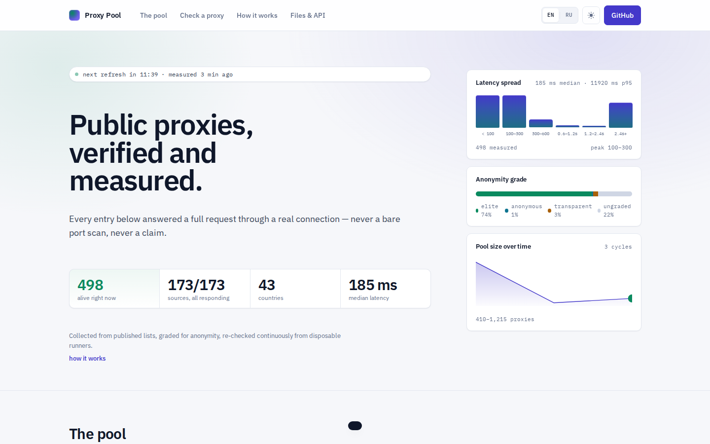
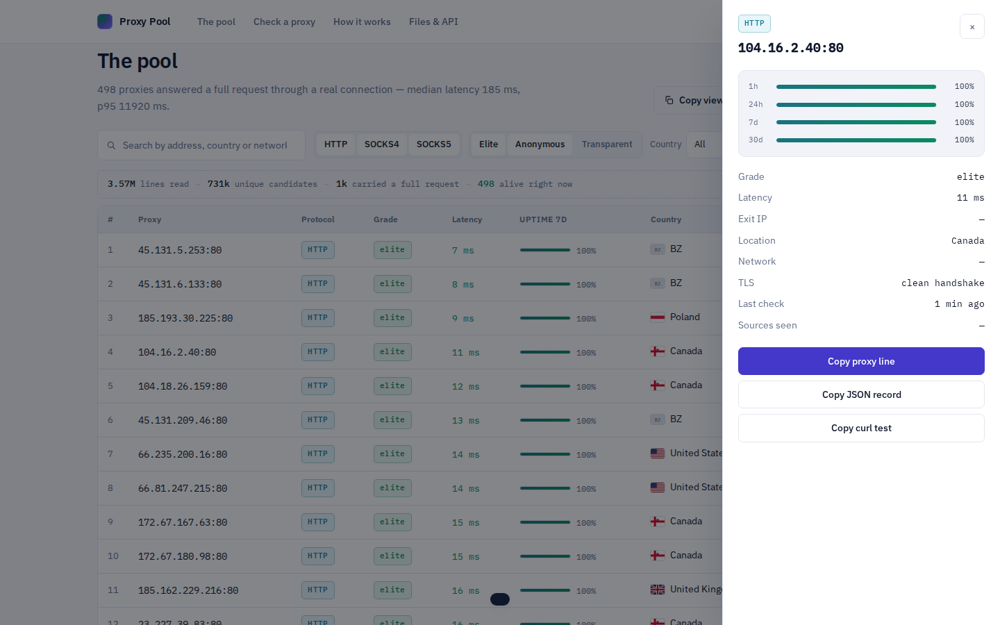
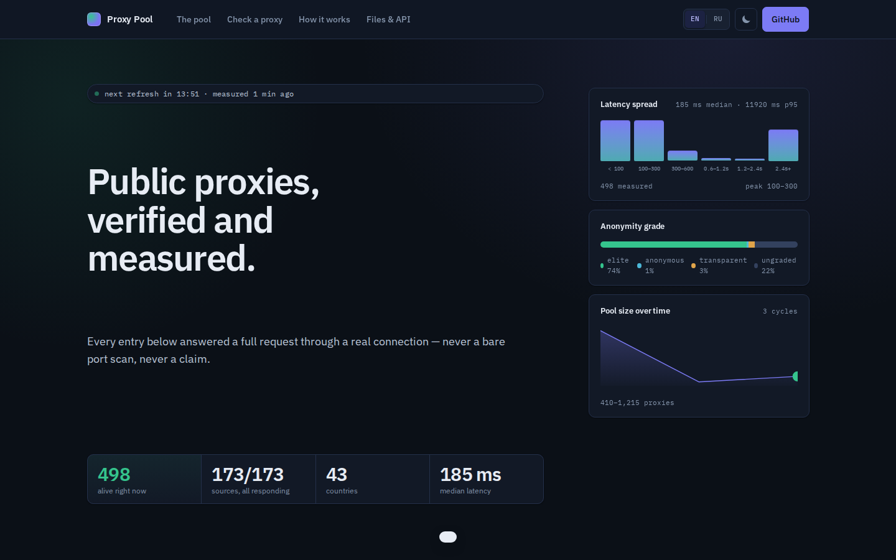
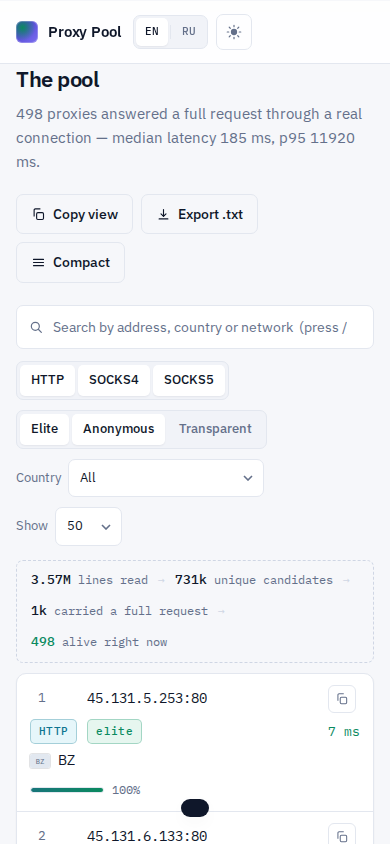
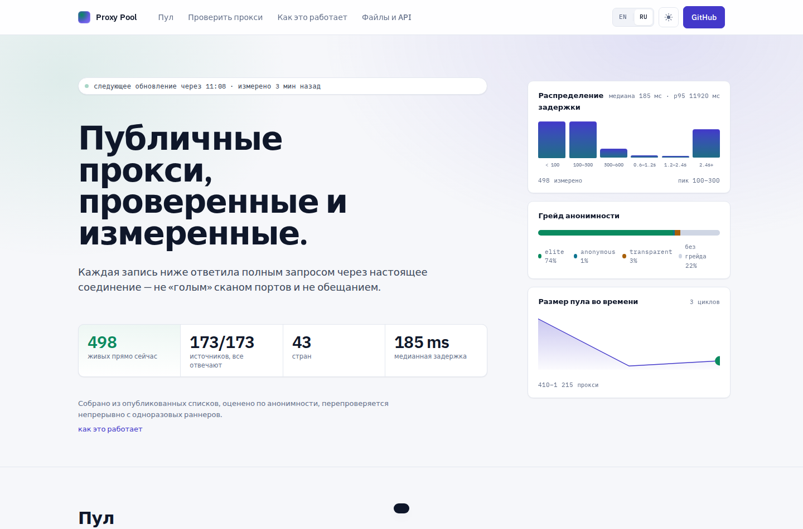
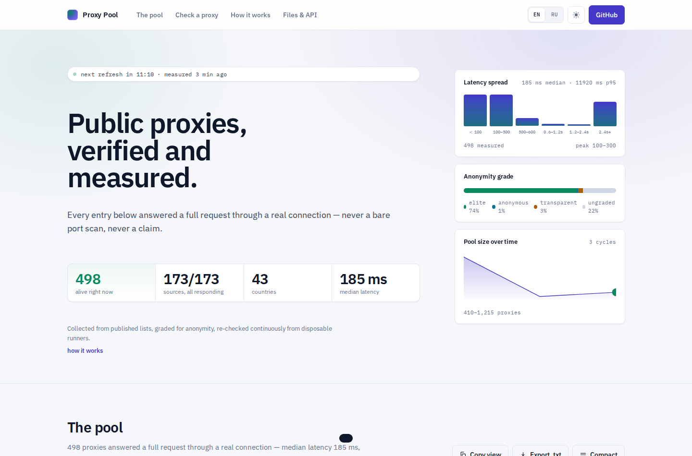
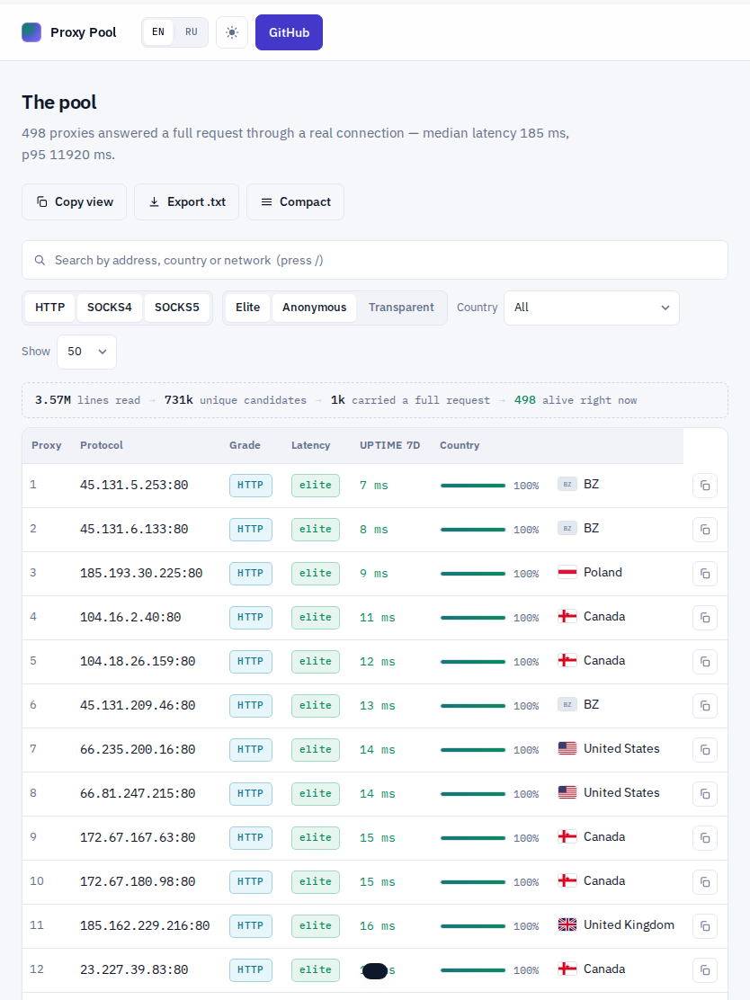

# open-proxy-pool

[](https://github.com/OWNER/REPO/actions/workflows/ci.yml)
[](https://github.com/OWNER/REPO/actions/workflows/refresh.yml)


[](LICENSE)
[](http://193.34.212.154:8931)

**A public proxy pool that is actually verified.** 194 published lists are
consumed as-is — nothing is scanned — and every candidate has to carry a full
request through a real connection before it earns a place in the pool. The
result is republished every fifteen minutes as plain text, JSON and a website.

Live pool size, latency spread and country distribution are on the badges
above; the [live demo](http://193.34.212.154:8931) runs the real site.

<br />
<p align="center">
  
</p>

## The 30-second version

```bash
# the whole pool, best quality first
curl -s https://cdn.jsdelivr.net/gh/OWNER/REPO@main/data/all.txt | head -20

# one protocol, one country
curl -s https://cdn.jsdelivr.net/gh/OWNER/REPO@main/data/socks5.txt
curl -s https://cdn.jsdelivr.net/gh/OWNER/REPO@main/data/country/US.txt

# full metadata: grade, latency, exit IP, uptime windows, network
curl -s https://cdn.jsdelivr.net/gh/OWNER/REPO@main/data/proxies.json | jq '.proxies[0]'
```

More languages, a working rotator and realistic expectations:
[docs/examples.md](docs/examples.md).

## Why this pool is different

|                          | Typical list repo      | this pool                                                                 |
| ------------------------ | ---------------------- | ------------------------------------------------------------------------- |
| **Verification**         | port open ≈ alive      | full request through the proxy, read to the last byte                     |
| **Anonymity**            | a column of claims     | graded from what the target actually saw                                  |
| **Freshness**            | daily cron             | every 15 minutes, with a re-check queue for living entries                |
| **What checks the pool** | your laptop            | disposable CI runners, never the operator's address                       |
| **Metadata**             | ip:port                | exit IP, latency percentiles, uptime windows, ASN, country, TLS-MITM flag |
| **Interface**            | a folder of .txt files | the same files, plus a website, API-style JSON and country shards         |

The honest numbers from the last cycle: **3.58M lines read → 732k unique
candidates → ~1.2k alive**. A public proxy population is mostly dead — this
pool exists so you never have to find that out yourself.

## What gets published

| File                                                     | Contents                                                                                          |
| -------------------------------------------------------- | ------------------------------------------------------------------------------------------------- |
| `data/all.txt`                                           | every working proxy as `proto://[user:pass@]host:port`, best quality first                        |
| `data/http.txt`, `data/socks4.txt`, `data/socks5.txt`    | per-protocol lists                                                                                |
| `data/top100.txt`, `data/top1000.txt`                    | highest-quality slice, plain `host:port`                                                          |
| `data/proxies.json`                                      | full metadata per proxy: anonymity, latency, exit IP, uptime windows, ASN, country, TLS-MITM flag |
| `data/country/<CC>.txt`                                  | per-country shards                                                                                |
| `data/stats.json`, `data/meta.json`, `data/history.json` | run statistics and the pool's recent life                                                         |
| `data/badges/*.json`                                     | shields.io endpoint payloads for the README badges                                                |

## Website

A static, dependency-free page that renders the pool: search, protocol and
grade filters, sorting, pagination, a per-proxy detail drawer with uptime
gauges, a latency histogram, the pool-size sparkline, a **proxy playground**
that checks any address on the spot, dark mode and full EN/RU localization.

<p align="center">
  
  
  
  
</p>

<p align="center">
  
  
</p>

```bash
node scripts/build-web-data.mjs   # refresh site/data/ from data/
python3 -m http.server -d site 8000
```

Open <http://localhost:8000>. The refresh workflow rebuilds the bundle on
every merge, and the site deploys anywhere static — GitHub Pages over this
repository works unchanged.

## How it works

```
sources.yaml ─► fetch ─► parse & dedupe ─► verify (matrix, disposable runners)
             ─► enrich ─► store ─► render ─► data/ + site/ ─► commit
```

1. **Collect** — 194 published lists, fetched as-is, once per cycle, with a
   contact-bearing user agent. No port scanning, ever.
2. **Parse** — bare `ip:port`, `scheme://`, credentials and annotation tails
   all count; duplicates merge with provenance.
3. **Verify** — handshake, then a complete response through the proxy.
   Connect-then-stall does not pass; bodies are capped at 256 KB.
4. **Enrich** — anonymity grade from the target's own view, exit IP, latency
   percentiles, rolling uptime windows, offline geo (DB-IP), TLS-MITM flag.
5. **Publish** — text lists, JSON with metadata, country shards, website data.

Full pipeline documentation: [docs/architecture.md](docs/architecture.md),
[docs/sources.md](docs/sources.md), [docs/operations.md](docs/operations.md).

## Run it yourself

```bash
npm ci
npm test                          # 103 tests, no network needed
npx tsx src/index.ts cycle        # one full cycle in-process
```

The pipeline needs no secrets to run: the scheduled refresh works on GitHub
Actions from free standard runners, and state lives in the `pool-state-*`
cache. Everything is configured by environment variables (`OPP_STORE=postgres`
for a durable database, `OPP_GEOIP_MMDB` for your own mmdb, `HEALTHCHECK_URL`
for a dead-man switch) — see [docs/operations.md](docs/operations.md).

Encoded sources are handled, not skipped: spys.one serves ports through a
packed script (run in a sandbox), advanced.name publishes base64 attributes —
roundproxies' metadata table and advanced.name's base64 attributes are
decoded in-repo, no headless browser. Its 500-row lists only answer POST with a
rows-per-page field, which the registry expresses as `method: post`. The
audit tool answers the question directly (`npx tsx src/index.ts check
spys-one-socks`).

One optional secret exists: `GFP_API_KEY` (a free key from
[getfreeproxy.com](https://getfreeproxy.com)) enables four extra sources that
serve pre-verified proxies from an authenticated API. Without it those sources
are skipped and the pool is built from the rest.

## Telegram bot

`bot/` is a dependency-free, single-file bot that serves the pool in a chat:
`/get socks5 US`, `/top`, `/stats`. It reads the same published JSON the
website uses, so it never touches a proxy itself.

```bash
BOT_TOKEN=… OP_POOL_URL=https://cdn.jsdelivr.net/gh/OWNER/REPO@main/data node bot/index.mjs
```

## Where this can go

A full brief — what the project is, what it measures that no competitor does,
the competitive map, and eight transformation directions evaluated — lives in
[docs/PROJECT-SPEC.md](docs/PROJECT-SPEC.md). It is written as a standalone
document you can hand to another model or a collaborator.

## Weekly roast

One command turns a cycle of measurements into a digest — the biggest gap
between what a list publishes and what answers, the most honest source, rank
movement and staleness. A weekly workflow writes it to `data/roast.md`; the
content never needs writing by hand.

```bash
npx tsx src/index.ts roast    # writes data/roast.md
```

## Edge API

`workers/api/` is a stateless Cloudflare Worker that serves the same files
with CORS and edge caching — deploy it with `wrangler deploy`, no database
or secrets involved:

```bash
curl https://<worker>.workers.dev/v1/proxies
curl https://<worker>.workers.dev/v1/list/socks5 | head
```

## Distributed verification

The pipeline can borrow check capacity: a coordinator hands batches to
volunteer nodes (`opp node`) and only accepts results for proxies it actually
assigned, so a lying node cannot invent proxies — cross-checks by CI and by
other nodes settle disagreements. See `src/distributed/` for the protocol.

```bash
COORDINATOR_URL=https://… npx tsx src/index.ts node    # on a volunteer box
```

## Roadmap

- [x] 173 sources, tolerant parsing, dedupe with provenance
- [x] Two-phase verification: liveness + anonymity grading
- [x] Enrichment: latency, uptime windows, geo, TLS-MITM flag
- [x] Text lists, JSON, country shards, shields badges
- [x] Website: search, filters, drawer, sparkline, playground, i18n
- [ ] Distributed verification via community validator nodes
- [ ] Historical per-proxy uptime pages (90-day retention)
- [ ] Optional Cloudflare Worker API with CORS and edge caching

## Source freshness

Independent from live-rate, the fetch pass dates every GitHub-hosted source
through the API and flags files untouched for over 90 days. An abandoned
source is the dangerous kind: it answers 200, passes every health check, and
every entry inside is years dead — the genre is full of them, and
`data/fetch-report.json` records `lastCommitDays` per source so a stale list
can never quietly masquerade as a live one.

## Contributing

New sources are the lifeblood — see
[CONTRIBUTING.md](CONTRIBUTING.md) for the registry format and the rules
(the list must be published, not scanned). Bug reports and parser fixes are
equally welcome; the historic `scheme://` regression is guarded by a test.
Shipping plan: [docs/launch-kit.md](docs/launch-kit.md).

## Safety & license

These proxies are run by third parties, most of them unintentionally exposed
services. Treat every entry as hostile: no credentials, no personal data, no
payments. Abuse reports and security issues: [SECURITY.md](SECURITY.md).
MIT licensed — [LICENSE](LICENSE). Geo data by DB-IP — [NOTICE](NOTICE).
